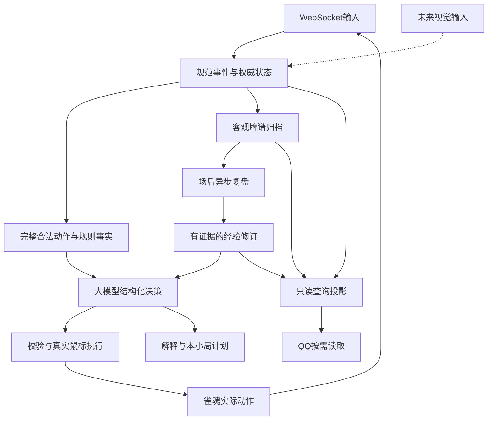

# 架构与范围

## 一条决策链

`浏览器 WebSocket → 协议解码 → 规范事件 → 权威状态与操作窗口 → 合法动作及确定性特征 → 大模型结构化选择 → 状态/时间/界面再校验 → 真实鼠标执行 → 协议事件确认`。

模型解释、当前局打法思路和跨场经验是旁路数据，不能回写客观状态。数据库保存事件、快照和决策之间的关联，QQ 与面板读取各自允许的投影。

## 模块与接口边界

| 模块 | 输入与输出 | 职责 |
| --- | --- | --- |
| 输入/会话 | `SourceEnvelope → DomainEvent / RecoveryBatch` | 首版 CDP 观察 WS，未来视觉适配器产生带证据与未知字段的事件/观察 |
| 状态与归档 | `DomainEvent → GameSnapshot` | 幂等归并、座位/局/场生命周期、事实持久化与恢复 |
| 规则 | `Snapshot + RawOperation → LegalAction[] + Features` | 服务器约束与规则交叉校验、向听进张、役种和算点，无策略排名 |
| 模型 | `DecisionContext → DecisionResult` | 唯一主动打牌选择、简短解释、具体小局计划更新 |
| 协调器 | `DecisionWindow + DecisionResult → ExecutionRequest` | 请求取消、迟到失效、有限纠错、共享时间池、执行去重 |
| 基础设施 | `ExecutionRequest + FreshUILayout → ExecutionReceipt` | 手牌/按钮定位、真实鼠标、立直/组合选择事务、输入后确认 |
| 经验 | `ArchivedMatch → Review → MemoryRevision` | 异步复盘、候选与稳定经验、风格和相关召回 |
| 查询/界面 | `Projection → HTTP / MCP / Panel` | QQ 只读查询，本机控制、状态、牌谱和计量 |

输入事实与 UI 定位分开。首版没有“用图像推理整桌牌局”的要求，但 WS 不提供屏幕坐标，仍需读取页面可见几何或用局部 CV 定位手牌/按钮。页面对象只能用于可见 UI 定位与核验，不能通过内部出牌函数、WebSocket 发送或读取未公开牌山代替正常玩法。

模型每次使用独立完整决策上下文，WebSocket增量事件先在本地归并。领域数据与[模型紧凑投影](model-wire-format.md)分离，通过公共字段提取、短引用、完整特征去重减少重复；真实token净收益和模型理解分别验证，不减少合法动作或关键事实。

## 技术实现方向

- 核心使用 Python：类型化数据契约、异步模型 HTTP/SSE、SQLite WAL、麻将规则库适配、Windows SendInput；浏览器控制采用 Playwright/CDP。具体依赖版本在初始化时锁定并核验 Windows 兼容性。
- 本地 HTTP 服务提供控制面板与只读查询，监听 loopback。QQ 使用一个很小的 Node MCP 适配器调用查询服务，避免把实时决策塞进长 QQ 会话或完整工具链。
- 标准麻将计算库只能复用确定性计算；不得调用传统策略选牌或依赖其推荐候选。库未覆盖的规则以适配与测试补足，不将未知当成确定答案。
- 默认单账号、单专用浏览器实例、单活动对局。浏览器profile留本机且独立于普通浏览器。当前由用户登录；自动复用登录态及可见登录流程已纳入2026-10-31的M9扩展计划。

## 首版产品行为

当前用户打开专用浏览器、登录并进入对局，在本机面板开启接管。程序读取真实房间规则、识别本家座位；未知模式、状态不一致或无法验证点击目标时暂停主动操作并记录原因。正常局间结算/继续可由确定的流程处理，整场终场保存后停止。自动登录、按明确指令匹配段位/加入/创建友人房已纳入[M9开发计划](lobby-automation.md)，实现和实测独立跟踪；购买与无指令连续匹配不在该计划内。

支持标准四人规则配置，包括东/南及延长场、赤牌与食断选项、起始点与结算差异、供托本场、连庄与终场条件。以服务器实际生命周期和规则为准。三麻、地方特殊役、比赛自定义机制超出首版；遇到不支持字段必须显式报告，不能自称兼容。

## 各阶段可交付物

先实现只读采集与可恢复牌谱；再实现规则和真实模型的影子决策；随后在隔离窗口验证输入并进入友人实战。查询、记忆与面板接入完整链路。影子模式不点击；主动模式才消耗真实行动机会。

整场历史与性能统计是产品的一部分。首版不要求接入前的账号历史回填，不要求导入旧视觉牌谱，不要求完整视觉输入；这些扩展边界保留在数据来源和输入接口中。

## 设计树的已关闭分支

纯模型边界、超时政策、浏览器、规则范围、成绩目标、预算、历史口径、大牌归属、QQ 触发、前台使用、经验自主权限、中断归档、历史起点、错误重试、本机入口、复盘时机、经验升级、被迫动作与验收门槛，均已有用户选择。剩余的是开发事实验证，不再把可查事实转成新的偏好问题。
